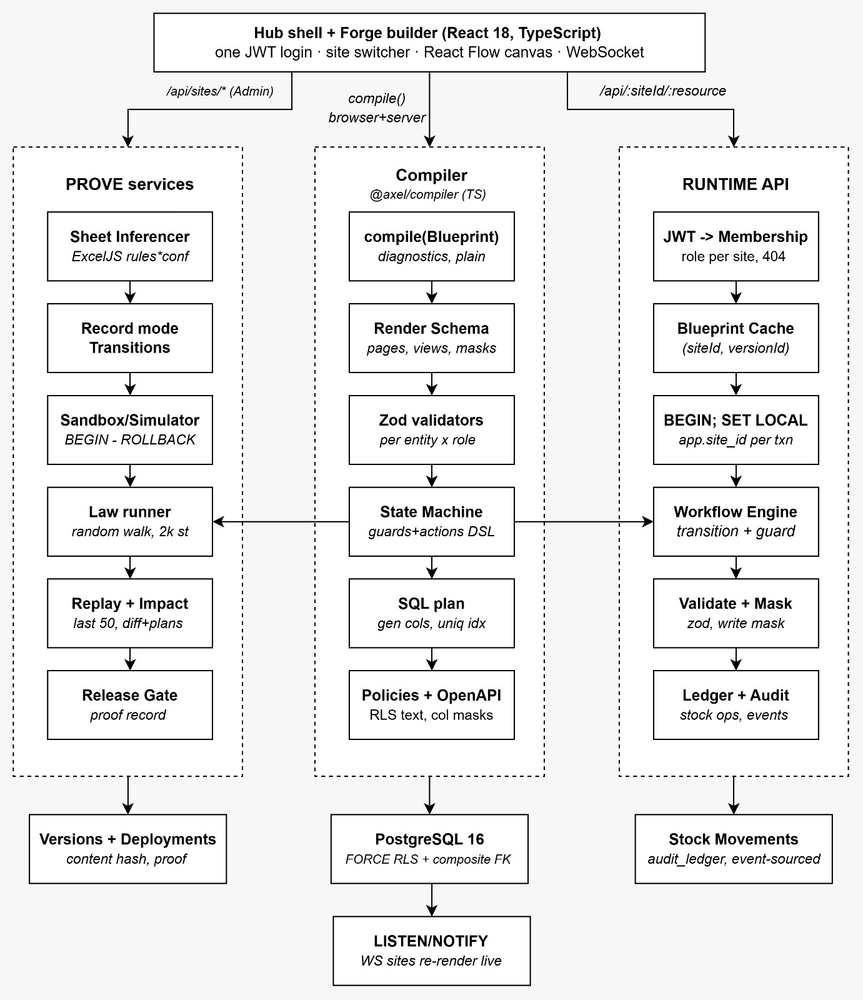
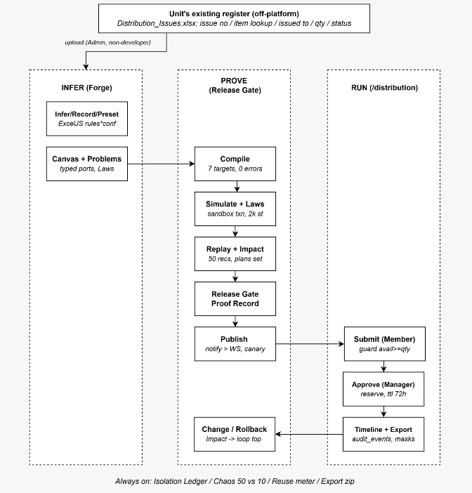

# Axel - Attested Multi-Site Execution Layer

**PS 03 OpsHub submission.** *Axel. Every site proven before it runs.*

Axel runs many completely different operations sites from one codebase. Every unit (Central Stores, Service Centre, Distribution, and any unit you add) is a **Blueprint**: one JSON document that declares its theme, layout, modules, fields, workflow, pages, roles and **Laws**. One compiler, one renderer, one API and PostgreSQL row-level security run them all.

Most platforms in this space let you *build* a site. Axel's focus is the part they leave to luck: **deriving** the site from what a unit already does, and **proving** every change is safe before it reaches real people and real stock.





---

## What is new here

Most platforms help you *build* a site. Axel focuses on what they leave to luck: **deriving** the site from what a unit already does, and **proving** every change is safe before it goes live.

| # | Novelty | In one line | Try it |
|---|---|---|---|
| 1 | Sheet Inferencer | Upload a unit's spreadsheet, get a working site with every guess explained | Hub, + From a spreadsheet |
| 2 | Laws + Release Gate | Rules in plain sentences, proven by a random walk before publish | Builder, Run gate |
| 3 | Replay Report | A change is tested against the last 50 real requests | Builder, Impact |
| 4 | Data-preserving rollback | Roll back with a plan for records created since | Builder, Versions |
| 5 | Proof-carrying releases | Every deployment stores why it was allowed | Builder, Versions |
| 6 | Reservation ledger | Stock reserved, committed, expired; proven under 50 concurrent approvals | Hub, Run chaos |
| 7 | Live isolation proof | Tenant isolation checked live from PostgreSQL's own catalog | Hub, Isolation Ledger |
| 8 | Typed-port builder | Wrong wiring is impossible; one compiler in browser and server | Builder canvas |
| 9 | Explained denials | Every refusal says why and who decided | Anywhere |
| 10 | Zero lock-in | Export Blueprint, docs, OpenAPI, data and history as a zip | Builder, Export |

### 1. Sheet Inferencer: the site is derived, not designed

- **Gap:** every builder starts from a blank canvas, so a process owner still needs someone technical.
- **What it does:**
  - Finds the stock list and the request register in the workbook.
  - Infers field types, money columns and choice lists (from dropdowns or repeated values).
  - Turns sheet formulas into calculated fields: `=D2*I2` becomes `qty * unit_price`.
  - Turns the **Status column into a workflow**: "Sanctioned" is read as approved, "Repairing" as in repair, "Issued" as assigned.
  - Enables modules from the columns it finds: "Approved by" enables Approval, "Serial No" enables PCB Repair, "Returned On" enables Returns.
  - Proposes Laws, pages and a layout, then imports the rows (opening stock through the ledger).
- **Why trust it:**
  - Every guess shows a **confidence %** and a **plain-English reason**.
  - Low-confidence guesses are highlighted as "check this".
  - Rule-based and deterministic: no AI service, no internet, same file gives the same site.
- **Try it:** Hub, **+ From a spreadsheet**, `demo/registers/Workshop_Tools.xlsx`. **Test:** `test:infer`

### 2. Laws and the Release Gate: nothing publishes without evidence

- **Gap:** low-code tools publish whatever the admin clicks; users find the mistakes.
- **Laws are rules in plain sentences**, for example:
  - "Members never see Unit price"
  - "Every Assignment comes from a request that was approved"
  - "Reserved stock never exceeds on-hand stock"
  - "This site never reads another site's data"
- **The Release Gate runs before every publish:**
  - **Compile:** zero errors allowed.
  - **Static check:** Laws checked against the Blueprint, for example a calculated field that would leak a hidden price.
  - **Random walk:** hundreds to thousands of actions as Members, Managers and Admins on **real data**, in a transaction that is always rolled back; every Law checked after every step.
- **If a Law breaks:** publish is blocked and the builder shows a **counter-example** (the exact steps that broke it) plus a **seed** to replay it.
- **Try it:** add a "Fast-track" step from submitted to assigned, then **Run gate**. You get "Law l2 broken at step 37". **Test:** `test:gate`

### 3. Replay Report: tested against what actually happened

- **Gap:** a "small" rule change can silently block real work.
- **What it does:**
  - Takes the last 50 real requests and their recorded history (same steps, same roles).
  - Replays them through the **live version** and the **draft**, side by side, in a rolled-back transaction.
  - Lists every request that would now go differently, and at which step.
- **Example output:** "3 of 50: submitted > approved would be blocked by a rule (today: allowed)".
- **Try it:** Service Centre builder, Workflow tab, give Approve the rule `qty <= 1`, then **Impact**. **Test:** `test:replay`

### 4. Impact Report and data-preserving rollback

- **Gap:** platforms roll back configuration but lose or orphan the data created since.
- **What it does:**
  - Classes every change as **additive**, **behavioural** or **destructive**, with live record counts.
  - If a removed state still holds records, publish **or rollback** needs a plan per state:
    - keep those records read-only, or
    - move them to another state (written to the audit trail).
  - Removed fields are hidden, never dropped.
  - Rollbacks run a short Release Gate on the older version too.
- **Try it:** Distribution: enable Returns, return one request, roll back, and choose "Move to closed". **Test:** `test:replay`

### 5. Proof-carrying releases

- Every deployment stores a **proof record**:
  - Blueprint content hash
  - gate steps, seed and result
  - replay summary and whether it was reviewed
  - plans chosen and the list of changes
- The deploy history records **why** each version was allowed live, not just **when**.

### 6. Reservation ledger with expiry, proven under concurrency

- **Gap:** counters get double-spent when two managers approve at once, and approved-but-unused stock stays locked forever.
- **What it does:**
  - Stock is an **append-only ledger**: receive, adjust, reserve, commit, release, return.
  - Approve **reserves**, assign or repair **commits**, return **gives back**.
  - Row locks on request and item, plus **idempotency keys**: a double-click is a no-op.
  - Stale screens are refused: "this record changed since you opened it".
  - **Reservations expire**: stock is released and the request goes back for re-approval.
- **Proof:** **Run chaos** fires 50 concurrent approvals at 10 units. **Exactly 10 succeed**, 40 are refused, and the ledger matches. **Test:** `test:workflow`

### 7. Isolation you can watch being proven

- **Gap:** row-level security leaks through forgotten FORCE, owner bypass, pooled connections, and foreign keys that reveal other tenants' rows.
- **What Axel does:**
  - FORCE RLS on every business table.
  - API database role **cannot bypass RLS** and **owns no tables**.
  - Site context is per transaction: no context means **zero rows**.
  - Composite `(site_id, id)` foreign keys: another unit's id looks exactly like a missing one.
  - Other units' data returns **404, never 403**.
  - The browser wipes its cache on every switch and drops late responses.
- **Try it:** Hub, **Isolation Ledger** (read live from PostgreSQL), then **Run live isolation check**. **Tests:** `test:isolation`, `test:stage`

### 8. Typed-port builder, one compiler everywhere

- Modules are nodes with **typed ports**: Approval needs a RequestStream; Material Assignment needs an ApprovedStream and a StockLedger.
- Wrong wiring or missing modules become plain-English problems ("Approval requires Request") with **one-click fixes**.
- Adding a module **changes the site**: Return Management adds a Return step, a Returns page and a stock action.
- Browser and API run the **same compiler**, so what the canvas accepts is exactly what the server accepts.
- Publishing is **live**: open windows re-render with no reload and no restart.

### 9. Explained denials everywhere

- "Only Manager, Admin can approve in Service Centre (transition t2)"
- "Approve blocked: available stock for SC-104 is 3, rule 'stock.available(item_id) >= qty' is not met"
- "You can't see Unit price in Central Stores (cost confidential). Ask a Manager."
- A Member's Excel export includes an **About** sheet listing the columns hidden from them.

### 10. Zero lock-in

- **Export** downloads a zip with:
  - `blueprint.json`
  - a generated plain-language `README.md` (**Explain**)
  - `openapi.json` (OpenAPI 3.1)
  - `data.xlsx` with all records
  - `deployments.json` with every proof record

---
## Login: password + one-time code (MiniMoth)

- **Step 1:** email and password, checked with bcrypt.
- **Step 2:** Axel asks [MiniMoth](https://minimoth.dev) to send a 6-digit code (WhatsApp first, SMS fallback); the user enters it and MiniMoth verifies it.
- **Then** Axel issues its session JWT carrying the user's **roles and allowed sites** (`sites: [{ slug, role }]`, `amr: ["pwd", "otp"]`). The server still re-reads the role from the database on every request, so a demotion applies on the very next click.
- The OTP challenge is signed with a different key from the session, so it can never be used as a login token.
- Keys live only in `.env` (`MINIMOTH_API_KEY`, never committed). `OTP_REQUIRED=all | admins | off`. With a `mm_test_` key nothing is sent and the code is `000000`.

## Repair, refurbishment and diagnostics

Service units get the depth a repair business runs on, built as general Blueprint features any unit can switch on:

- **Check stage with a rework loop:** received, approved, in repair, **testing**, closed, returned. A failed test sends the job back for rework; "beyond economical repair" ends it. A Law (`via_state`) guarantees nothing closes without passing testing, and the Release Gate blocks any shortcut.
- **Diagnosis record:** fault category, board model, root cause, parts replaced, firmware version, technician, bench hours, test result, rework rounds, outcome and warranty. Test result, reworks and outcome are filled in by the workflow itself.
- **Repeat-failure and warranty warning** when a serial number comes back, and a **board passport** (visits, reworks, last outcome, warranty, parts) on the board history.
- **Repair analytics:** boards in repair, waiting for testing, first-time test passes, average bench hours, faults by category, outcomes. Dashboard widgets can now filter (`where`).
- **Public tracking:** any unit can set `publicTracking`; customers open `/track`, enter a serial number and see only the stage and dates, never names, prices or notes.

## How Axel compares

| Capability | Retool / Appsmith | Odoo / Zoho | Wix / Webflow | Axel |
|---|---|---|---|---|
| Many differently themed, isolated sites from one codebase | - | heavy customisation | one site each | yes |
| Site derived from the unit's existing spreadsheet, with explained confidence | - | - | - | yes |
| Rules (Laws) proven by a random walk before publish, with counter-examples | - | - | - | yes |
| Proposed change replayed against real history | - | - | - | yes |
| Rollback that plans for data created since | - | - | - | yes |
| Tenant isolation enforced in the database and checkable live | - | - | - | yes |
| Non-developer can change workflow and publish live | partly | needs a consultant | - | yes |

---

## Table stakes, done properly

JWT login with bcrypt; roles per unit (Public, Member, Manager, Admin) and a People tab; a site switcher (Ctrl+K) that changes layout, theme, pages and workflow, not just colours; four layout shells; table, kanban (drag to transition), queue and dashboard views (Recharts); calculated fields validated by the compiler; Excel templates with dropdowns, dry-run imports with row-by-row errors and all-or-nothing commits; role-masked exports; presets (Inventory Starter, Approval Chain, Repair Shop); versions with preview on live data; board history by serial number for PCB Repair.

---

## How Axel meets PS 03

| Requirement | Where |
|---|---|
| Hub layer: global JWT login, bcrypt, roles, user management, site switcher, theme engine, module catalogue | `apps/api/src/auth.ts`, `members.ts`, `apps/web/src/pages/Hub.tsx`, `renderer/SiteShell.tsx`, builder palette |
| Site layer: `{ siteId, slug, theme, modules, pages, roles }` | Blueprint in `packages/compiler/src/types.ts`; [docs/SITES.md](docs/SITES.md) |
| Module and node layer: 13 typed nodes | `packages/compiler/src/registry.ts`; [docs/MODULE_REGISTRY.md](docs/MODULE_REGISTRY.md) |
| Visual builder (React Flow): drag, connect, presets, field and workflow config | `apps/web/src/builder/` |
| Config saved as JSONB; one renderer for every site | `site_versions.config`; `apps/web/src/renderer/` |
| `/api/:siteId/:resource`; `site_id` on every business table | `apps/api/src/resources.ts`; `migrations/001_core.sql` |
| Isolation at API and database level, tested per endpoint | `site.ts`, RLS migrations, `test/isolation.test.ts`, `test/api.test.ts`, `test/stage.test.ts` |
| Request, approval, assignment with transactional stock | `workflow.ts`, `ledger.ts`, `test/workflow.test.ts` |
| Calculated fields (TOTAL = QTY x PRICE) with schema validation | `formula` fields, `packages/compiler/src/expr.ts` |
| Preview, publish, versioned releases, rollback, deploy history | `versions.ts`, `gate.ts`, `replay.ts`; builder Gate, Impact and Versions tabs |
| Per-site analytics (Recharts) | `analytics.ts`, dashboard view |
| Bulk Excel import and export with role restrictions | `excel.ts`, `test/excel.test.ts` |
| Scoped REST APIs incl. login, sites, components, requests, approvals, assignments, Excel export | [docs/API.md](docs/API.md) |
| Architecture diagram, module registry, data model, API design, README | this file, [docs/](docs/) |
| Seeded demo data plus offline backup | `pnpm seed`, `backups/axel-demo.dump`, `restore.ps1` |

---

## Quick start

**Needs:** Docker Desktop, Node.js 20+, pnpm (`npm i -g pnpm`).

**Windows, fresh machine:**
```powershell
powershell -ExecutionPolicy Bypass -File .\first-run.ps1
```
Day to day: `.\start.ps1` and `.\stop.ps1`. Reset the demo data: `.\restore.ps1`.

**macOS / Linux:**
```bash
cp .env.example .env
pnpm install
docker compose up -d db          # wait ~10 s the first time
pnpm migrate && pnpm seed
pnpm dev:api                     # terminal 1
pnpm dev:web                     # terminal 2, then open http://localhost:5173
```

Generate the demo spreadsheets: `pnpm registers` (written to `demo/registers/`).

## Demo accounts (password `demo1234`)

| Email | Role |
|---|---|
| admin@axel.dev | Hub admin, Admin of every unit |
| manager@cs.dev / member@cs.dev | Central Stores |
| manager@sc.dev / member@sc.dev | Service Centre |
| manager@dist.dev / field@dist.dev | Distribution |

The login page has one-click buttons for each. The full stage script is [docs/DEMO_SCRIPT.md](docs/DEMO_SCRIPT.md).

## Tests

With Axel running: `pnpm test` (39 tests).

| Suite | Proves |
|---|---|
| `test:isolation` (11) | Cross-unit reads are 404, writes refused, header must match URL, masked fields never sent or written, another unit's ids look nonexistent, 60 interleaved pooled requests never mix, no context means zero rows, RLS forced on every table |
| `test:workflow` (4) | 50 concurrent approvals vs 10 units, role on transition, stale versions refused, double-click idempotent |
| `test:excel` (4) | Dry-run row errors, all-or-nothing commit, Member cannot import, export follows the role mask |
| `test:api` (4) | Every brief endpoint works for its unit and refuses other units |
| `test:gate` (4) | Unchanged units pass, a leaked price is blocked by a Law, a shortcut that skips approval is caught with a counter-example, publishing without a passing gate is refused |
| `test:replay` (4) | Unchanged drafts replay identically, a stricter rule shows which past requests it blocks, a removed state with records needs a plan, publishing it without one is refused |
| `test:infer` (4) | A repair register infers approval, repair and returns with a mapped formula; a stock sheet infers an inventory site; upload is hub-admin only; members can be managed but nobody changes their own role |
| `test:stage` (4) | Isolation Ledger and its live check, export zip contents, Explain, board history scoped to its unit |

## Project layout

```text
axel/
  packages/compiler/   Blueprint types, expression DSL, diagnostics, validators, render schema, typed ports,
                       module effects, presets, Laws, Sheet Inferencer, Explain, OpenAPI (browser and server)
  apps/api/            Express API: auth, site scope, resources, workflow engine, stock ledger, versions,
                       Release Gate, Replay and Impact, Excel, analytics, members, isolation ledger, live events
    migrations/        PostgreSQL schema with FORCE RLS
    seed/              Three demo units, run through the real workflow engine
    scripts/           Docs and demo-register generators
    test/              39 tests in 8 suites
  apps/web/            React: hub, builder (React Flow), renderer with four layouts
  docs/                Architecture, module registry, sites, data model, API, demo script, diagrams
  demo/registers/      Example spreadsheets for the Sheet Inferencer
```

## Documentation

- [Architecture](docs/ARCHITECTURE.md): Hub, Builder, API, PostgreSQL; request and publish flows
- [Module registry](docs/MODULE_REGISTRY.md): the 13 modules as typed builder nodes (generated by `pnpm docs`)
- [Seeded sites](docs/SITES.md): each unit explained from its Blueprint (generated)
- [Data model](docs/DATA_MODEL.md) and [API](docs/API.md)
- [Demo script](docs/DEMO_SCRIPT.md), with fallbacks and judge Q&A

## Honest scope

Exactly the 13 approved modules; depth over breadth. Not built yet, though the Blueprint and compiler are designed for them: Record mode (derive a workflow by acting it out), an interactive sandbox simulator, generated database columns for formulas, canary releases to selected roles, offline field consumption, and camera scanning of serial labels.
