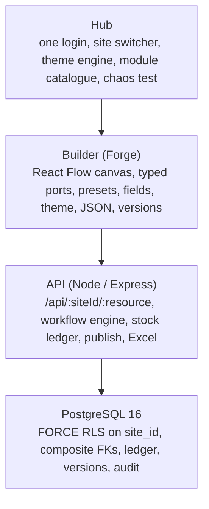
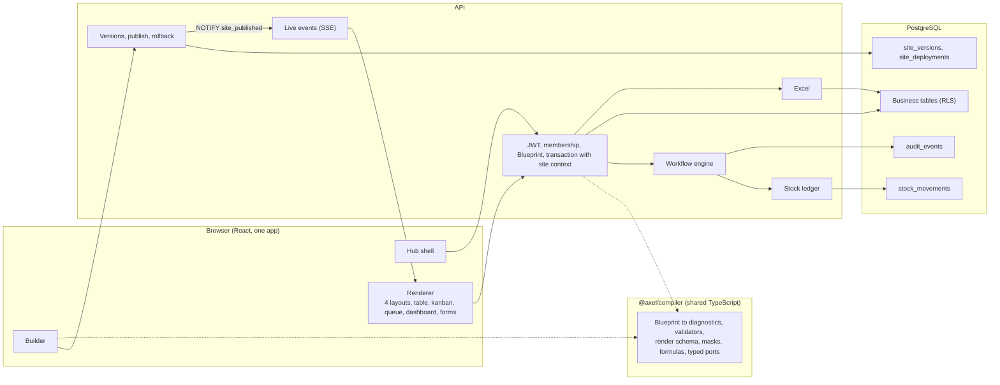
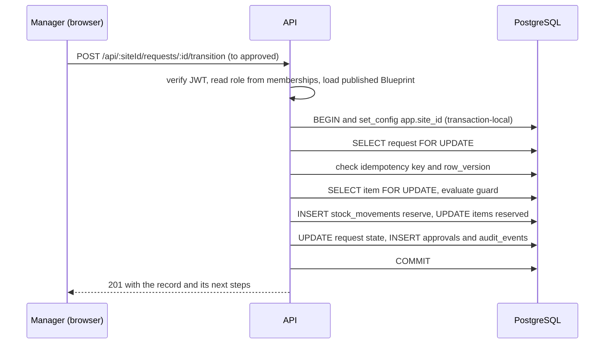
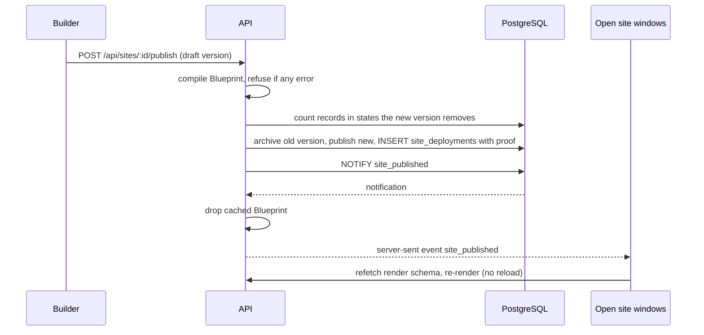

# Architecture

Axel has one codebase. The only thing that differs between sites is the **Blueprint**, a JSON document stored per version in `site_versions.config`. The compiler is a shared TypeScript package, so the problems an admin sees on the builder canvas are exactly what the API would reject.

## Hub, Builder, API, PostgreSQL

## Components

## The three layers from the brief

| Brief layer | In Axel |
|---|---|
| Hub layer | JWT login (bcrypt), memberships per site, roles Public/Member/Manager/Admin, site switcher with cache wipe, theme engine (CSS variables plus four layout shells), module catalogue in the builder palette |
| Site layer | Blueprint `{ siteId, slug, name, theme, modules, entities, workflows, laws, pages, roles, nav, edges }` |
| Module and node layer | 13 registry entries with typed input/output ports and dependencies; adding a module applies its effects (states, steps, entities, pages) to the Blueprint |

## A request that changes stock

Two approvals for the same request serialise on the request row lock; the second sees the new state and is refused. Approvals for different requests on the same item serialise on the item row lock, so reserved stock can never exceed on-hand stock.

## Publishing a change

Rollback is the same path pointed at an earlier version. Data is never deleted: fields a version does not know are hidden, not dropped.

## Isolation in three layers

1. **Database.** Every business table has `site_id`, `ENABLE` and `FORCE ROW LEVEL SECURITY`, and a policy comparing it to `app.site_id`. The API connects as `axel_app`, which owns nothing and cannot bypass RLS. Context is set with `set_config(..., true)` inside each transaction, so pooled connections never carry a stale site; with no context, queries return zero rows. Foreign keys are composite `(site_id, id)`, so a row cannot reference another site's row, and another site's id looks exactly like a missing id.
2. **API.** Middleware checks the JWT, the membership for that site and that `X-Site-Id` matches the URL. Reads of other sites return 404 so existence is not leaked. Bodies are validated against the Blueprint's per-role write mask; responses are filtered by the read mask.
3. **Client.** Every query key starts with the entity and site id; switching sites removes cached queries and discards any response that started before the switch.

## Design decisions

- **Shared tables with RLS, not a schema per site.** One codebase and hot publish need shared tables; FORCE RLS plus composite keys gives isolation without per-site migrations.
- **Compile first.** The same compiler runs in the browser (instant feedback) and the server (source of truth).
- **Ledger, not counters.** On-hand and reserved stock are only changed by ledger operations under row locks, with idempotency keys, and can be recomputed from `stock_movements`.
- **Server-sent events for live updates.** One direction is all that is needed; no extra dependency.
