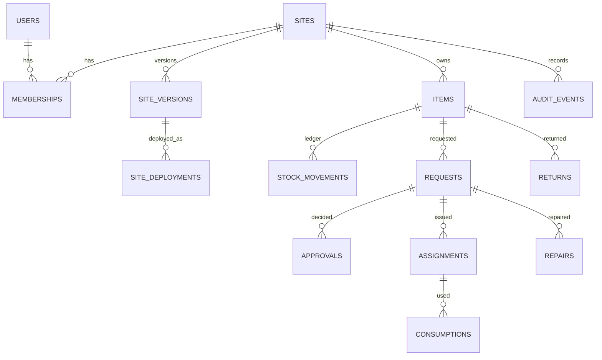

# Data model

PostgreSQL 16. All ids are UUIDs. Every business table has `site_id uuid NOT NULL`, FORCE row-level security and a policy `site_id = app_site()`. Entities keep typed core columns plus `data jsonb` for Blueprint-defined fields (GIN indexed).



## Hub tables (not site-scoped)

| Table | Purpose |
|---|---|
| `users` | email (citext, unique), bcrypt `password_hash`, `is_hub_admin` |
| `sites` | `slug` (unique), `name`, `published_version_id` |

## Site-scoped platform tables

| Table | Purpose |
|---|---|
| `memberships` | `(site_id, user_id)` to role. A user may read their own rows across sites; role changes need Admin and nobody changes their own (trigger). |
| `site_versions` | Blueprint `config` (JSONB), `content_hash` (sha256 of canonical JSON), `status` draft/published/archived, `updated_rev` for draft conflicts |
| `site_deployments` | Every publish and rollback with its `proof` (hash, changes, warnings), `deployed_by`, `rollback_of` |
| `audit_events` | Event history: create, update, transition (with idempotency key), import, export, stock moves, reservation expiry |
| `recordings`, `law_runs` | Reserved for Record mode and the Release Gate |

## Business tables

| Table | Core columns | Notes |
|---|---|---|
| `items` | `name`, `on_hand`, `reserved` | `CHECK on_hand >= 0`, `CHECK reserved <= on_hand`; SKU unique per site via `(site_id, data->>'sku')` |
| `stock_movements` | `item_id`, `kind`, `qty`, `ref_id`, `idempotency_key`, `expires_at`, `consumed_by` | Append-only ledger, unique `(site_id, idempotency_key)` |
| `requests` | `item_id`, `qty`, `state`, `requested_by` | Workflow state; formula fields computed from `data` |
| `approvals` | `request_id`, `decision`, `decided_by`, `note` | Written by the Approval module on decision |
| `assignments` | `request_id`, `item_id`, `qty`, `state` | Written by Material Assignment on assign |
| `consumptions` | `assignment_id`, `qty`, `idempotency_key` | Field usage |
| `returns` | `ref_type`, `ref_id`, `item_id`, `qty` | Returned material |
| `repairs` | `request_id`, `serial_no`, `fault`, `diagnosis`, `state` | Opened and closed by PCB Repair steps |

Every entity table also has `row_version` (optimistic concurrency), `created_under_version`, `created_at`, `updated_at`, and `UNIQUE (site_id, id)` so other tables can use composite foreign keys.

## Stock ledger

| Kind | on_hand | reserved | Written by |
|---|---|---|---|
| receive | + | | Stock page, Excel import (opening qty) |
| adjust | +/- | | Stock page (Manager+) |
| reserve | | + | Approve (with expiry) |
| commit | - | - | Assign, Start repair |
| release | | - | Reject, expiry job |
| return | + | | Return step |

`available = on_hand - reserved`. The view `v_ledger_balance` recomputes both from the movements; the chaos test compares it with the item row.

## Row-level security

```sql
ALTER TABLE requests ENABLE ROW LEVEL SECURITY;
ALTER TABLE requests FORCE ROW LEVEL SECURITY;
CREATE POLICY site_iso ON requests
  USING (site_id = app_site()) WITH CHECK (site_id = app_site());
-- app_site() = NULLIF(current_setting('app.site_id', true), '')::uuid
```

Roles: `axel_owner` owns the tables and runs migrations; `axel_app` is what the API uses and has no BYPASSRLS.
